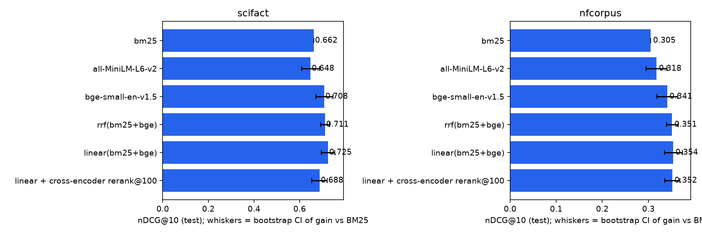

# Hybrid retrieval benchmark: BM25 vs dense vs fusion vs reranking, measured properly

The retrieval layer decides most of a RAG system's quality, and teams often pick it on vibes: "embeddings are better than keyword search", "always add a reranker". This repo measures those choices on two public [BEIR](https://github.com/beir-cellar/beir) datasets, with the discipline a production decision needs:

- **Tuned on train, reported on test.** The fusion weight and RRF constant are picked on SciFact's train queries and NFCorpus's dev queries, then frozen.
- **Uncertainty on every comparison.** Each gain over BM25 comes with a paired bootstrap 95% CI over queries.
- **Latency next to quality.** The table reports milliseconds per query on a laptop (Apple M4 Pro), measured.
- **Sanity-checked against published baselines.** My BM25 scores **0.662** nDCG@10 on SciFact, against **0.665** in the BEIR paper.

## Results (held-out test queries)



**SciFact** (5,183 abstracts, 300 test claims)

| System | nDCG@10 | Recall@100 | Δ nDCG@10 vs BM25 [95% CI] | ms/query |
|---|---|---|---|---|
| BM25 (own implementation) | 0.662 | 0.886 | n/a | 0.4 |
| all-MiniLM-L6-v2 | 0.648 | 0.928 | −0.014 [−0.054, +0.025] | 0.9 |
| bge-small-en-v1.5 | 0.708 | 0.943 | +0.046 [+0.009, +0.084] | 0.9 |
| RRF (BM25 + bge) | 0.711 | 0.965 | +0.049 [+0.028, +0.070] | — |
| **Linear fusion (BM25 + bge), α tuned** | **0.725** | **0.965** | **+0.062 [+0.034, +0.092]** | — |
| Linear + MS MARCO cross-encoder rerank@100 | 0.688 | 0.965 | +0.025 [−0.008, +0.059] | 449 |

**NFCorpus** (3,633 medical documents, 323 test queries)

| System | nDCG@10 | Recall@100 | Δ nDCG@10 vs BM25 [95% CI] | ms/query |
|---|---|---|---|---|
| BM25 | 0.305 | 0.243 | n/a | 0.2 |
| all-MiniLM-L6-v2 | 0.318 | 0.315 | +0.013 [−0.011, +0.035] | 1.9 |
| bge-small-en-v1.5 | 0.341 | 0.309 | +0.036 [+0.014, +0.058] | 0.6 |
| RRF (BM25 + bge) | 0.351 | 0.312 | +0.046 [+0.034, +0.059] | — |
| **Linear fusion, α tuned** | **0.354** | **0.318** | **+0.049 [+0.030, +0.068]** | — |
| Linear + cross-encoder rerank@100 | 0.352 | 0.318 | +0.047 [+0.030, +0.063] | 507 |

The fusion rows add only the cost of the retrievers they combine. The full output, including the tuning grids, is in [`results/`](results/).

## What I take from this

1. **"Embeddings beat BM25" depends on the embedding model.** MiniLM, the most common default, is *not* significantly better than BM25 on either dataset, and is nominally worse on SciFact. bge-small is.
2. **Hybrid is the robust choice.** BM25 + bge fusion beats the best single retriever on both datasets, and its confidence intervals are tighter than either retriever alone: the two make different mistakes. Recall@100 rises to 0.965 on SciFact, which matters most if a later stage reads the top-k.
3. **A reranker is not free accuracy.** The MS MARCO cross-encoder trained on web search *lowered* nDCG@10 on scientific claims (0.725 → 0.688) and gained nothing on medical questions, while adding ~450–500 ms per query. That is domain shift: check a reranker on your own data before you ship it.
4. **Tuning fusion is cheap and worth it.** The optimal BM25 weight was 0.3 on SciFact and 0.2 on NFCorpus. Untuned RRF gets most, but not all, of the gain.

My BM25 is 0.02 below the published NFCorpus number, because it skips stemming (Anserini uses Porter). That is a deliberate simplicity choice and is listed under Limitations.

## Repo layout

```
src/hrb/
  bm25.py      BM25 as one sparse matrix-vector product per query (k1=0.9, b=0.4, Anserini defaults)
  dense.py     bi-encoder index, embeddings cached to disk, MPS/CUDA when available
  fusion.py    reciprocal rank fusion and min-max-normalised linear fusion
  rerank.py    cross-encoder second stage
  metrics.py   nDCG@k (trec_eval linear gain), Recall@k, MRR@k, paired bootstrap
  bench.py     tune-on-train / report-on-test benchmark → results/
  api.py       FastAPI: POST /search (hybrid), POST /answer (grounded answer with citation checking)
```

## Grounded answers with citation checking

`POST /answer` retrieves passages, asks Claude to answer **only** from them with `[doc-id]` citations, and returns the cited ids split into `citations` (retrieved) and `unsupported_citations` (ids the model cited that were never retrieved). Hallucinated sources become a field you can alert on rather than something a user finds. Without `ANTHROPIC_API_KEY` the endpoint returns 503 instead of degrading silently. The answer quality of this endpoint is **not** benchmarked here. The citation parsing and the failure path are unit-tested with a stubbed client.

## Run it

```bash
uv venv && uv pip install -e '.[dense,api,dev]' matplotlib
./scripts/download.sh                 # SciFact + NFCorpus from the BEIR mirror
python -m hrb.bench                   # ~8 min on an M4 Pro, most of it embedding + reranking
pytest
HRB_CORPUS=data/scifact/corpus.jsonl HRB_DENSE_MODEL=BAAI/bge-small-en-v1.5 uvicorn hrb.api:app
curl -s localhost:8000/search -H 'content-type: application/json' -d '{"query":"vitamin D and bone density","k":5}'
```

`docker build -t hrb . && docker run -p 8000:8000 hrb` serves BM25 search over SciFact.

## Limitations

- Two small datasets. BEIR has 18, and conclusions on legal or code search could differ.
- One cross-encoder. A domain-matched or larger reranker (e.g. bge-reranker) might help where MS MARCO MiniLM did not.
- No stemming in BM25, and a single run (dense retrieval is deterministic, so variance comes only from the query sample, which the bootstrap captures).
